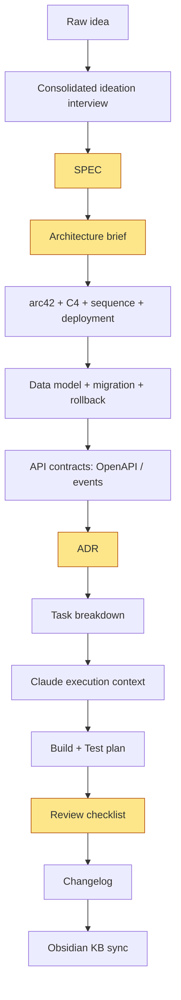

# SDLC — Software Development Life-cycle toolkit

Open SDLC toolkit for building software with Claude — ideation → ship pipeline with artefact templates, Definition-of-Ready / Definition-of-Done gates, Claude skills that generate first drafts, and a lint script that checks artefact quality.

Not theory, not a course — a folder you clone or fork, install the Claude Code plugin in `plugin/`, and work through the pipeline via skills. Each skill is self-contained (`plugin/skills/<name>/SKILL.md` + its own `templates/` + `references/`); shared snippets that don't belong to a single skill live in `document-templates/`. Texts live in the repo next to the code, gate stages protect against "straight to code", and Claude generates artefact drafts by protocol instead of "from inspiration".

> **Cleanup 2026-05-25** — the toolkit is down to 11 atomic skills after dropping composite wrappers (`design`, `detail`, `impl-prep`, `ship`) and deprecated stubs (`draw-sequence`, `design-db`, `plan-migration`, `define-api`). Atomic skills are now the only entry-point. See [CHANGELOG.md](CHANGELOG.md).

## How to wire it into your project

```bash
# 1. Clone or copy sdlc/ into the root of your project
cp -r sdlc/ <your-project>/

# 2. Install the Claude Code plugin — skills drive the per-stage drafts
cd <your-project>
ln -s "$(pwd)/sdlc/plugin" ~/.claude/local-plugins/sdlc
#   or: claude /plugin install ./sdlc/plugin
#   ↳ see plugin/README.md for the skill order and what's inside each skill.

# 3. Start a new feature — each skill creates the artefacts it owns
SLUG=my-feature
claude /sdlc:interview $SLUG          # idea-brief.md
claude /sdlc:write-prd $SLUG          # PRD.md
# … and so on through the pipeline.

# 4. Run repo-local checks
make -C sdlc sdlc-check
```

Each skill copies its own starter shape from `plugin/skills/<name>/templates/` into `delivery/<slug>/`. Shared snippets that don't belong to any single skill (e.g. `CHANGELOG.md`, `rollback-plan.md`, `review-checklist.md`) live in `document-templates/` and are pulled by hand when the feature needs them.

Then go stage by stage. Don't try to fill everything at once: artefact size scales with task size (see [MVP vs Full](00-overview/mvp-vs-full.md)).

## Process diagram



Yellow nodes are **gates** — without them the next stage doesn't start.

## Pipeline stages

> Each skill is invoked directly via `/sdlc:<name> <slug>`. No composite wrappers — orchestrate phases by calling atomics in sequence.

| Stage | Skill (source of truth) | Artefact | Owner |
|------|-------------------------|----------|-------|
| Ideation (14-phase interview) | [interview](plugin/skills/interview/SKILL.md) | `idea-brief.md` (15 sections) | PM/Eng/CTO |
| PRD **🚪 GATE** | [write-prd](plugin/skills/write-prd/SKILL.md) | `PRD.md` | PM+Lead |
| Architecture (SAD + ADRs + C4 L1/L2) **🚪 GATE** | [architecture-design](plugin/skills/architecture-design/SKILL.md) | `sad.md` + `adr/NNNN-*.md` | Architect |
| Sequence diagrams (PRD §4 audit + per-UC completion) | [complete-sequence-diagrams](plugin/skills/complete-sequence-diagrams/SKILL.md) | `sad.md §6` flows + `### Coverage: US/AC → flows` block | Tech Lead |
| Persistence (data model + migrations) | [generate-data-model](plugin/skills/generate-data-model/SKILL.md) | `data-model.md` + paired `.up.sql`/`.down.sql` + audit | Backend Lead |
| API contracts | [api-forge](plugin/skills/api-forge/SKILL.md) | `openapi.yaml` (+ `events.md` if applicable) | Backend Lead |
| ADR (post-hoc) **🚪 GATE** | [decide-adr](plugin/skills/decide-adr/SKILL.md) | `adr/NNNN-*.md` | Decision owner |
| Task breakdown | [break-tasks](plugin/skills/break-tasks/SKILL.md) | `tasks/_epic.md` + `tasks/tracker.md` + `tasks/<task>.md` | Tech Lead |
| Test plan | [plan-tests](plugin/skills/plan-tests/SKILL.md) | `test-plan.md` | QA/Backend |

## Navigation

- [Process map](00-overview/process-map.md) — full Mermaid diagram with gates
- [Definition of Ready](00-overview/definition-of-ready.md) — before code
- [Definition of Done](00-overview/definition-of-done.md) — after code
- [MVP vs Full set](00-overview/mvp-vs-full.md) — what to pull for XS/S vs M+
- [Rollout plan](00-overview/rollout-plan.md) — 6-phase introduction
- [Process metrics](00-overview/process-metrics.md) — process-health metrics
- [File structure](00-overview/file-structure.md) — full repo layout per feature
- [Example: rate-limiting](examples/rate-limiting/) — full end-to-end example on a synthetic "rate limiting per user" feature
- [Example: goals-tracking arc42](examples/goals-tracking/arc42.md) — filled-in Arc42 sample
- [Plugin: sdlc](plugin/) — Claude Code plugin with 9 atomic stage skills + 2 cross-cutting skills (`fix-term`, `classify-size`). Ideation is the consolidated 14-phase **`sdlc:interview`** skill. GATE skills hard-refuse when the prereq artefact is missing. Install: symlink into `~/.claude/local-plugins/sdlc/` or `claude /plugin install ./sdlc/plugin`.

## Repo-local checks

```bash
make sdlc-check
make sdlc-metrics
```

`sdlc-check` validates local markdown links, unfilled placeholders in feature artefacts, required artefacts per task size, ADR status (must be Accepted before downstream stages), and basic OpenAPI YAML validity.

## Painless rules

- Templates are short (≤1 page), examples sit alongside.
- Everything lives in the repo next to the code, not in Confluence.
- Claude generates artefact **drafts** — humans edit, not write from scratch.
- Each gate is 1 review, not a committee.
- Once a month run a retro: which artefacts did anyone actually read? Trim the rest.
